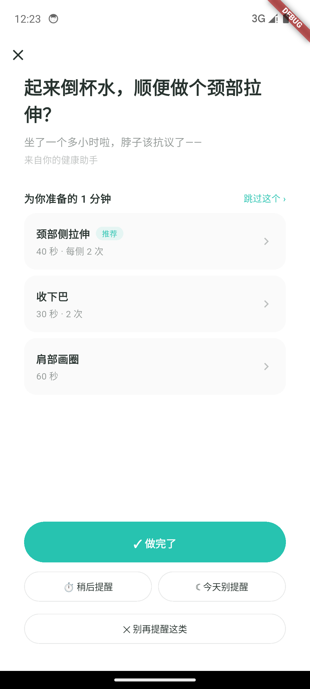

# Health Assistant · 健康助手

[](https://github.com/Colin994/health-assistant/actions/workflows/ci.yml)

一款面向「久坐干预」的健康管理 Flutter 应用：以本地倒计时提醒（久坐拉伸 / 喝水 / 护眼）为核心，手机传感器实时计步辅助，形成「提醒 → 拉伸 → 反馈 → 自适应」的健康闭环；智能手表连接为 Pro 期规划（经 Health Connect / HealthKit 读取活动数据）。

> 状态：开发中（8 屏 UI 与手机传感器计步已落地，倒计时提醒引擎开发中）

## ✨ 已实现

- **8 屏完整 UI**：首启引导 / 今日 / 拉伸 / 我的 / 设置，三 Tab 架构，逐屏走查通过
- **自建设计系统**：设计 token（色/字/形/距）落地为 ThemeData，8 屏设计稿经版式审计
- **手机传感器计步**：Step Detector 逐 tick 采集（EventChannel + SensorManager），当日基线本地持久化续计，真机验证与 MIUI 计步一致
- **工程化**：Melos 16 包 monorepo，统一 lint 规则，一键 analyze / gen / test

## 📐 架构

三层五组件的 clean architecture + 单向数据流：

| 层 | 组件 | 落点 |
|---|---|---|
| 表现层 | Screen / ViewModel | `feature_*`（六件套：ScreenRoute/Screen/VM/State/Intent/Event） |
| 领域层 | UseCase | `domain_all` |
| 数据层 | Repository / DataSource | `core_health` 等 |

- **DI/状态**：双容器边界——get_it + injectable 管 domain/core（UseCase/Repository，microPackage 模式，app 壳聚合注册）；flutter_riverpod 3 管表现层（Notifier 六件套：ScreenRoute/Screen/VM/State/Intent/Event），provider 内可取 get_it，反向禁止
- **错误处理**：Result 模式（Success/Failure）；Repository 接口不暴露插件类型，保证数据源可替换
- **模块四分法**：`base_*`（基础设施）/ `feature_*`（功能）/ `domain_*`（用例）/ `core_*`（数据与模型）
- **规范**：架构总纲 + 命名规范（含反例速查表）双文档约束所有代码

## 🖼 截图

| 引导 | 今日（首页） | 拉伸 |
|---|---|---|
|  |  |  |

完整 8 屏设计稿与实现走查记录见 `design/ui_walk/`（过程留档在 `archive/`）。

## 🛠 技术栈

Flutter / Dart ^3.12 · Melos 8 workspace · flutter_riverpod 3（表现层）· get_it + injectable 3（领域/数据层）· shared_preferences · health 13.x（Pro 期手表连接启用）· drift（规划中）· flutter_lints 6

## 🚀 运行

```bash
melos bootstrap      # 初始化 16 包 workspace
melos run analyze    # 全模块静态分析
melos run gen        # build_runner 代码生成（DI 模块）
melos run test       # 全模块测试
cd app && flutter run
```

> 计步需系统「身体活动」权限（应用内引导授权）。Health Connect / HealthKit 为 Pro 期手表连接的数据通道，当前版本不依赖。

## 🗺 Roadmap

- 久坐规则引擎与提醒链路（core_reminder）
- drift 本地持久化（core_database）
- 用户档案与反馈事件（core_profile / core_model）
- snapshot / golden 测试体系（snapshot_test）

## 🤖 开发方式

架构设计、技术决策与验收由本人制定并把关，AI 辅助执行编码与设计稿生成。关键平台问题（如 Health Connect 授权链路、构建工具链）的排查与决策过程记录在提交历史中。
