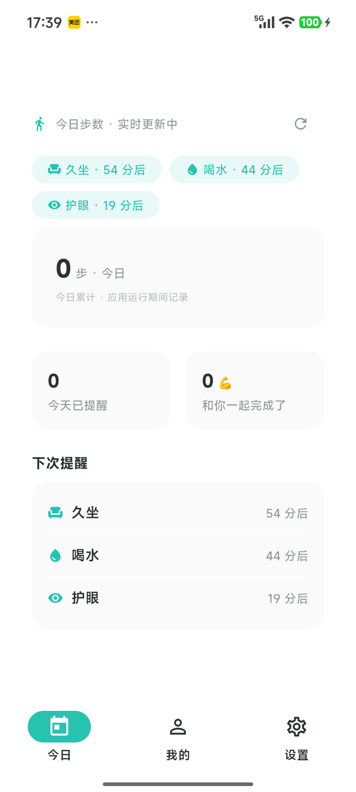
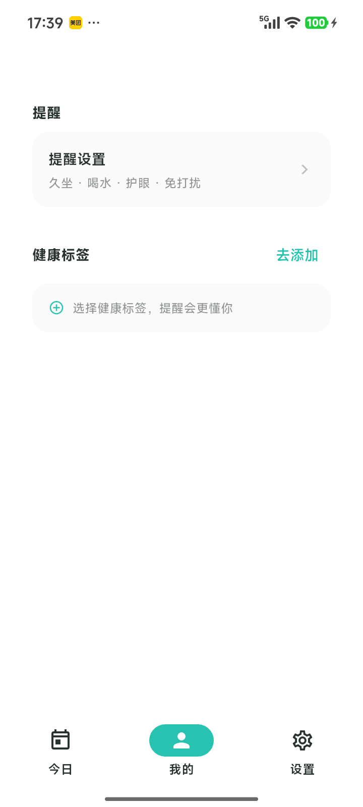
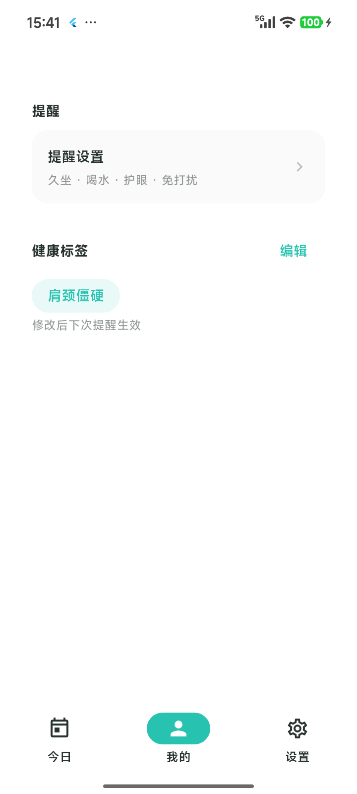
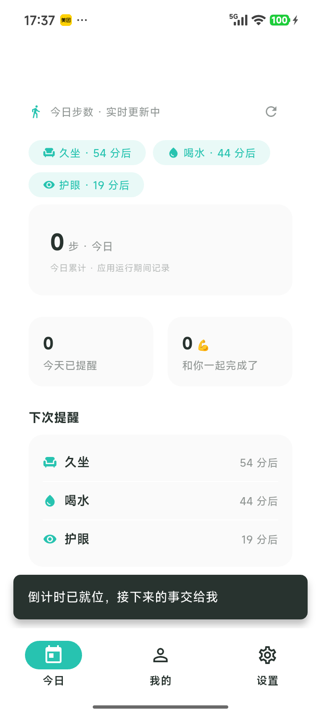
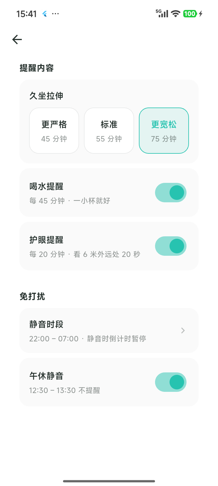
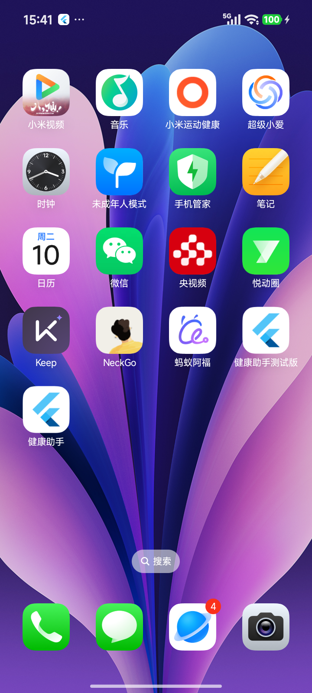

# Health Assistant · 健康助手

[](https://github.com/Colin994/health-assistant/actions/workflows/ci.yml)

一款面向「久坐干预」的健康管理 Flutter 应用：以本地倒计时提醒（久坐拉伸 / 喝水 / 护眼）为核心，手机传感器实时计步辅助，形成「提醒 → 拉伸 → 反馈 → 自适应」的健康闭环；智能手表连接为 Pro 期规划（经 Health Connect / HealthKit 读取活动数据）。

> 状态：**W2 已完成 + 2.5D 花园小游戏落地**（v1.1.0）——提醒引擎端到端 + 慢植物花园（等距 3D 场景 / 接阳光 / 看星星）真机走查通过

## ✨ 已实现

- **倒计时提醒引擎**：三类提醒（久坐拉伸/喝水/护眼），静音=暂停、档位/开关变更次轮生效、活动打断重置（走动不误报）、四态反馈（做完了/稍后/今天别提醒/别再提醒这类）、自动降频（近 7 天负面反馈 >50% 自动放宽）、被杀期闹钟兜底 + 开屏补记账
- **通知链路**：flutter_local_notifications + schedule-next 模式（每类只排下一次闹钟），精确闹钟拒批自动降级
- **健康标签**：引导时选择 → 自动开启对应提醒 → 我的页可编辑（保存后下次提醒生效）
- **手机传感器计步**：Step Detector 逐 tick 采集，当日基线本地持久化，权限应用内自愈
- **8 屏完整 UI + v8 信息架构**：提醒设置在「我的」、两级分组（提醒内容/免打扰）、下次提醒逐行展示、降频告知横幅
- **慢植物花园（2.5D 等距）**：AI 生成的低多边形等距花园场景（晨/午/暮/夜同构图随时段切换），花畦锚点式种植（点场景中的白框花畦种下/查看植物），阳光经济 + 押花册 + 8 件等距装饰商店；植物 5 物种 × 6 阶段全部 iso 风
- **颈部动作玩法**：前置摄像头 ML Kit 人脸欧拉角驱动——接阳光（侧屈摇头对准接住，含金阳光充能引导）、看星星（仰头对准收集，抬头/低头方向提示），离画自动暂停
- **工程化**：Melos 17 包 monorepo，引擎单测 15 用例（假时钟全场景），渠道走查测试双渠道；master 包 R8 keep 规则覆盖 ML Kit

## 🖼 截图

| 今日（活倒计时） | 我的（标签+提醒） | 提醒设置（两级分组） |
|---|---|---|
|  |  |  |

| 首启引导 | 标签编辑 | 设置 |
|---|---|---|
|  |  |  |

> **美术资产说明**：游戏美术资源（花园场景/植物/装饰等 AI 生成位图）不随本仓库分发，仅本地私有保存；仓库已保留 `app/assets/game/` 目录占位，自行补齐资产后即可运行游戏页面。仓库内 `design/game_art/tools/` 保留了完整的出图管线脚本（可直接重新生成）。

## 📐 架构

三层五组件的 clean architecture + 单向数据流：

| 层 | 组件 | 落点 |
|---|---|---|
| 表现层 | Screen / ViewModel | `feature_*`（六件套：ScreenRoute/Screen/VM/State/Intent/Event） |
| 领域层 | UseCase | `domain_all` |
| 数据层 | Repository / DataSource | `core_reminder` / `core_profile` / `core_health` 等 |

- **DI/状态**：双容器边界——get_it + injectable 管 domain/core；flutter_riverpod 3 管表现层
- **错误处理**：Result 模式；Repository 接口不暴露插件类型
- **模块四分法**：`base_*`（基础设施）/ `feature_*`（功能）/ `domain_*`（用例）/ `core_*`（数据与模型）

## 🛠 技术栈

Flutter / Dart ^3.12 · Melos 8 workspace · flutter_riverpod 3 · get_it + injectable 3 · flutter_local_notifications 19 · shared_preferences · health 13.x（Pro 期手表连接启用）· flutter_lints 6

## 🚀 运行

```bash
melos bootstrap      # 初始化 17 包 workspace
melos run analyze    # 全模块静态分析
melos run gen        # build_runner 代码生成（DI 模块）
melos run test       # 全模块测试
cd app && flutter run --flavor dev    # 开发版（与正式版可共存）
cd app && flutter build apk --flavor master --release --split-per-abi  # 正式版（必须 split:版本号带 ABI 前缀,未拆分包会被系统判降级）
```

> 计步需系统「身体活动」权限（应用内引导授权 + 自动自愈）。Health Connect / HealthKit 为 Pro 期手表连接的数据通道，当前版本不依赖。

## 🗺 Roadmap

- ✅ W2：倒计时提醒引擎端到端（已完成）
- ✅ 2.5D 花园小游戏：场景/种植/接阳光/看星星/商店/押花册（真机走查通过）
- W3：通知深链直达拉伸页 + 通知内快捷反馈按钮
- W4：云端 LLM 个性化文案
- Pro：智能手表连接（付费墙 + HealthKit/HC 授权回归）

## 🤖 开发方式

架构设计、技术决策与验收由本人制定并把关，AI 辅助执行编码与设计稿生成。关键平台问题（如 Health Connect 授权链路、构建工具链）的排查与决策过程记录在提交历史中。
